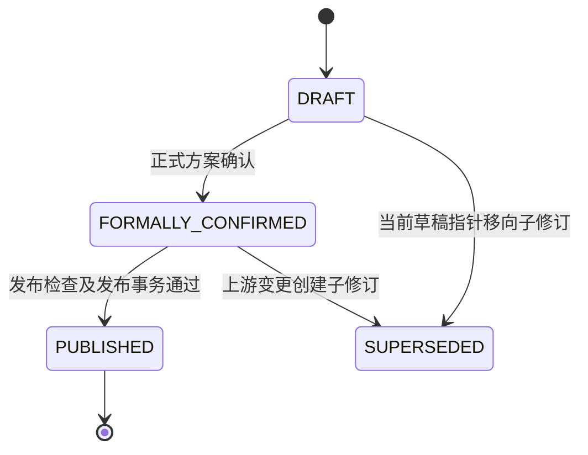

# 第一期 API、状态机、权限与审计

## 1. API 设计原则

API 前缀为 `/api/v1`。查询返回不可变修订的投影，写入使用业务命令而不是对结果表做通用 CRUD。任何针对既有预算修订的写命令必须同时包含：

- `If-Match: "<budget_revision_id>"`；
- `Idempotency-Key: <uuid>`；
- 请求追踪 ID；
- 业务命令需要的原因、完整对象键和预期失效摘要版本。

API 金额和理论人数使用十进制字符串，整数人数和 ppm 使用 JSON 整数。客户端不得提交页面格式化后的万元、百分数字符串或中间计算结果。

成功创建新修订或异步作业返回 `202 Accepted`：

```json
{
  "annual_budget_id": "...",
  "previous_revision_id": "...",
  "new_revision_id": "...",
  "job_id": "...",
  "invalidated": [{"type": "FORMAL_PLAN_CONFIRMATION", "id": "..."}],
  "links": {"revision": "...", "job": "..."}
}
```

只读查询支持游标分页、稳定排序和字段白名单，默认每页 100、最大 500；批量写命令单次最多 5,000 个明确对象键，超过时客户端分批但每批仍独立原子。不允许客户端以任意字段名拼接排序 SQL。导出始终是异步作业。

一期不引入分布式缓存。不可变修订查询使用内容哈希作为 HTTP `ETag`，汇总读取使用 PostgreSQL 投影表和必要索引；任何缓存都只能以 `revision_id + result_hash` 为键，不能以“当前草稿”作无版本缓存。

## 2. 资源和查询接口

| 方法与路径 | 用途 |
|---|---|
| `GET /annual-budgets?department_id=&fiscal_year=` | 查询预算链及当前草稿、当前发布指针 |
| `GET /annual-budgets/{id}/revisions` | 查询修订历史 |
| `GET /revisions/{revision_id}` | 查询修订清单、生命周期、确认和结果摘要 |
| `GET /revisions/{revision_id}/diff?against=` | 比较两个修订的组件、输入和结果 |
| `GET /revisions/{revision_id}/targets` | 部门及赛道目标、差异和容差 |
| `GET /revisions/{revision_id}/combinations` | 预算组合及异常，游标分页 |
| `GET /revisions/{revision_id}/entry/campuses` | 校区建议、确定值、依据和合计 |
| `GET /revisions/{revision_id}/entry/details` | 入口明细、边界和分配证据 |
| `GET /revisions/{revision_id}/parameters/rates` | 比例参数、来源、边界和锁定 |
| `GET /revisions/{revision_id}/parameters/planned-new-students` | 计划新生人次和处理状态 |
| `GET /revisions/{revision_id}/parameters/resource-finance` | 班均、价格、转换和结转参数 |
| `GET /revisions/{revision_id}/parameters/discounts` | 明细折扣、综合目标和解锁状态 |
| `GET /revisions/{revision_id}/results/season-details` | 四季人数、收入、班均和取整追踪 |
| `GET /revisions/{revision_id}/validations` | 按组、状态和范围筛选校验 |
| `GET /revisions/{revision_id}/scenarios` | 候选、不可行或计算未完成结果 |
| `GET /jobs/{job_id}` | 作业状态、阶段、进度和安全错误摘要 |
| `GET /audit-events` | 按预算、对象、操作者、角色和时间筛选审计 |

所有修订查询默认读取路径中的精确 `revision_id`，不能自动替换为当前草稿。需要当前指针时必须先查询 `annual_budget`。

## 3. 命令接口

### 3.1 预算链与来源

| 方法与路径 | 命令 |
|---|---|
| `POST /annual-budgets` | 创建部门财年预算链和首个草稿 |
| `POST /revisions/{id}:derive` | 从草稿或发布基线派生新草稿 |
| `POST /revisions/{id}/targets:replace-and-lock` | 数据维护人员整套导入并锁定学校版部门与赛道目标及依据 |
| `GET /target-set-versions/{id}` | 查询精确目标版本、来源证据、锁定角色快照和固定万元容差 |
| `POST /source-snapshots:build` | 登记异步作业，通过只读来源适配器抽取、聚合、对账并固化快照 |
| `POST /source-snapshots` | 人工登记已知来源批次 |
| `POST /source-snapshots/{id}:reconcile` | 对账花名册与最新宽表分区 |
| `POST /source-snapshots/{id}:freeze` | 数据维护人员接受已对账快照质量 |
| `POST /source-snapshots/{id}/rate-reference-versions` | 以冻结快照、目标财年、样本门槛和四季成熟证据生成不可变历史比例参考版本 |
| `GET /rate-reference-versions/{id}` | 查询比例参考版本、来源快照和精确/回退/人工必填计数 |
| `GET /rate-reference-versions/{id}/references` | 按稳定游标分页查询分子分母、回退原因和 ppm 系统初值 |

### 3.2 组合和入口

| 方法与路径 | 命令 |
|---|---|
| `POST /revisions/{id}/combinations:generate-draft` | 从当前冻结快照生成历史预算组合草稿并派生新修订 |
| `GET /combination-set-versions/{id}` | 查询精确组合版本及全部组合明细 |
| `POST /revisions/{id}/combinations:replace-draft` | 原子保存完整组合变更集 |
| `POST /revisions/{id}/combinations:confirm` | 部门预算负责人确认组合版本 |
| `POST /revisions/{id}/entry-total:save-and-lock` | 数据维护人员录入并锁定财年入口总值 |
| `GET /entry-total-versions/{id}` | 查询精确财年入口总值版本 |
| `POST /revisions/{id}/entry-total:unlock` | 派生新修订并解锁入口总值 |
| `POST /revisions/{id}/campus-entry:generate-suggestions` | 生成整套校区建议作业 |
| `GET /campus-entry-suggestion-versions/{id}` | 查询精确建议版本及全部校区建议明细 |
| `POST /revisions/{id}/campus-entry:replace-draft` | 原子保存整套校区确定值和依据 |
| `POST /revisions/{id}/campus-entry:confirm` | 一次确认全部校区及绑定入口总值 |
| `POST /revisions/{id}/entry-scope:replace-draft` | 保存精确维度的人工纳入/排除例外及全组合判定证据 |
| `GET /entry-scope-versions/{id}` | 查询精确入口范围版本、例外和判定证据 |
| `POST /revisions/{id}/entry-scope:confirm` | 部门预算负责人确认当前入口范围版本 |
| `POST /revisions/{id}/entry-detail:calculate` | 生成入口明细初始分配版本并派生新修订 |
| `GET /entry-detail-set-versions/{id}` | 查询精确入口明细版本、分配证据和默认软边界 |

入口保存命令必须提交整套集合或显式差异集及集合内容哈希，服务端重建完整集合后再校验；不得逐行产生局部已确认状态。

当前已实现学校版收入目标版本与闭合校验、历史组合初稿、组合整套替换与确认、入口总值锁定、校区入口、入口范围、入口明细、比例参数、计划新生、四季人数、资源财务参数、班均、折扣参数、逐季收入结转、三阶段确定性自动调平、折扣解锁、候选应用及完整计算作业编排。入口总值解锁、正式发布和导出仍属于后续纵切；接口表保留其已确定契约，但不得误报为已上线。

### 3.3 参数

| 方法与路径 | 命令 |
|---|---|
| `POST /revisions/{id}/rate-parameters:replace-draft` | 保存比例值和边界草稿 |
| `GET /rate-parameter-versions/{id}` | 查询精确比例版本、边界确认、锁定来源和复制例外 |
| `POST /revisions/{id}/rate-boundaries:confirm` | 确认明确参数键集合的边界 |
| `POST /revisions/{id}/rate-parameters:lock` | 单条或批量锁定，整批事务 |
| `POST /revisions/{id}/rate-parameters:unlock` | 单条或批量解锁并失效下游 |
| `POST /revisions/{id}/rate-parameters:change-and-lock` | 修改与锁定原子完成 |
| `POST /revisions/{id}/rate-parameters:copy-cross-year-locks` | 按完整去财年键复制上一财年已锁定值，未匹配项生成例外 |
| `POST /revisions/{id}/planned-new-students:change-and-lock` | 按完整季节明细填写原因并锁定整数 |
| `POST /revisions/{id}/planned-new-students:unlock` | 解锁人工计划并失效下游 |
| `GET /planned-new-student-versions/{id}` | 查询精确人工计划版本及锁定零值、正值和待锁定状态 |
| `POST /revisions/{id}/resource-finance:replace-draft` | 保存完整资源财务参数草稿和证据 |
| `POST /revisions/{id}/resource-finance:confirm` | 部门预算负责人确认完整版本 |
| `GET /resource-finance-parameter-versions/{id}` | 查询班均、价格、含税转换、结转及独立确认 |
| `POST /revisions/{id}/discount-parameters:replace-draft` | 保存折扣和综合目标参数草稿 |
| `POST /revisions/{id}/discount-parameters:confirm` | 部门预算负责人独立确认当前完整折扣版本 |
| `GET /discount-parameter-versions/{id}` | 查询完整明细折扣、各层综合折扣目标及确认状态 |

批量参数命令的请求体必须展开为完整参数键数组并携带 `batch_content_hash`。服务端先校验全部项，再一次性创建组件版本；任一项失败返回完整错误列表且不创建新修订。

比例草稿和锁定命令以 100 ppm（0.01 个百分点）为最小输入精度。部门预算负责人确认的是“稳定参数键＋上下界”指纹；当前值在已确认边界内变化不会使边界确认失效，边界变化则必须重新确认。同财年派生必须精确继承锁定状态；跨财年只按去除财年的完整键匹配，不允许模糊回退，任何未匹配、目标边界未确认或复制值越界都会形成复制例外并阻止发布。

计划新生人次命令必须显式提交季节、赛道、产品、入口属性、年级、科目和校区，不接受通配或部分键。值使用严格非负整数，0 必须连同原因显式锁定；空值由明细不存在表达，解锁后保留原人数并进入“已填写待锁定”。非入口行允许没有入口分配记录；正数入口绝对量只排斥同一财年第一季的人工计划，后续季仍由推演结果判断是否适用。人工计划版本查询保留写入时的 `PENDING_HEADCOUNT_EVALUATION` 历史状态；人数结果以 `ENTRY_ABSOLUTE`、`APPLICABLE_LOCKED`、`NOT_APPLICABLE` 或 `REQUIRED_MISSING` 给出本次计算结论。该组件不是调平变量，也不进入最大余数法。

### 3.4 计算、调平和发布

| 方法与路径 | 命令 |
|---|---|
| `POST /revisions/{id}/headcounts:calculate` | 生成四季人数、分组取整轨迹和阻断校验，并派生新修订 |
| `GET /headcount-result-versions/{id}` | 查询精确人数结果、理论分数、整数值、实际比例和取整证据 |
| `POST /revisions/{id}/class-sizes:validate` | 基于已确认资源财务版本校验取整后班均 |
| `GET /class-size-result-versions/{id}` | 查询完整季节明细的班均状态、缺口和阻断证据 |
| `POST /revisions/{id}/revenues:calculate` | 生成明细收入、逐季结转、年度汇总和综合折扣校验 |
| `GET /revenue-result-versions/{id}` | 查询收入明细、部门/赛道季度与年度汇总及阻断证据 |
| `POST /revisions/{id}/target-closures:validate` | 按部门及各赛道分别执行元级年度收入目标闭合校验 |
| `GET /target-closure-result-versions/{id}` | 查询目标、计算收入、带符号差异、万元容差和闭合状态 |
| `POST /revisions/{id}:calculate` | 数据维护人员为当前修订幂等登记 `phase1-full-calculation-v1` 完整计算作业 |
| `POST /revisions/{id}/optimization-runs` | 按当前可开放阶段生成候选；可显式选择 `EXACT_ENUMERATION`、`CP_SAT_ENTRY_ONLY` 或 `CP_SAT_ENTRY_AND_RATES`，并固化各自资源上限 |
| `GET /revisions/{id}/optimization-runs/latest` | 恢复当前修订最近一次不可变求解、候选和证明 |
| `GET /revisions/{id}/discount-unlocks/current` | 按当前输入指纹恢复折扣解锁申请及确认状态 |
| `POST /revisions/{id}/discount-unlocks:request` | 数据维护人员发起折扣解锁 |
| `POST /revisions/{id}/discount-unlocks:confirm` | 部门预算负责人绑定不可行证明确认解锁 |
| `POST /revisions/{id}/scenarios/{scenario_id}:apply` | 数据维护人员应用 `OPTIMAL` 候选，在同一事务创建新组件版本、不可变修订及完整计算作业 |
| `POST /revisions/{id}/scenario-applications/{application_id}:revert` | 数据维护人员一键撤销仍为当前草稿的候选应用；追加恢复应用前输入的新修订并登记完整复算，不改写历史 |
| `GET /revisions/{id}/publication-readiness` | 查询分组发布硬约束、实际值和修复入口 |
| `POST /revisions/{id}:confirm-formal-plan` | 部门预算负责人发起完整复算；全部通过后才生成正式确认修订 |
| `POST /revisions/{id}:publish` | 再次复核硬约束和确认指纹，发布不可变年度基线 |
| `GET /revisions/{id}/detail-diff` | 按稳定业务键比较两个修订中的可调参数明细，区分业务值变化与证据元数据变化 |
| `POST /revisions/{id}:export` | 数据维护人员或部门预算负责人异步生成审计截止快照归档包 |
| `GET /audit-archives/{id}` | 查询归档包大小、内容哈希、清单哈希和下载地址 |
| `GET /audit-archives/{id}/download` | 在部门权限范围内下载不可变 ZIP 归档包 |

不存在 `force-publish`、`ignore-validation`、`merge-combination`、`expand-tolerance` 或直接修改 `season_budget_result` 的接口。

## 4. 错误模型

所有错误使用稳定 `code`、人类可读 `message`、`scope_key`、`repair_route` 和 `trace_id`：

```json
{
  "code": "REVISION_CONFLICT",
  "message": "预算草稿已产生新修订",
  "latest_revision_id": "...",
  "conflicts": [{"object_type": "RATE_PARAMETER", "object_key": {}}],
  "trace_id": "..."
}
```

HTTP 映射：

- `400`：协议或基础类型错误；
- `401`：未认证；
- `403`：角色无权执行命令；
- `404`：精确 ID 不存在或不在访问范围；
- `409`：修订冲突、幂等键载荷冲突、状态不允许或唯一键冲突；
- `422`：业务校验失败，返回逐项稳定校验码；
- `429`：用户或预算链作业限流；
- `500/503`：技术失败或依赖不可用，不回显堆栈、SQL、令牌或敏感来源行。

同一幂等键和相同规范请求体返回第一次结果；同一键但请求体哈希不同返回 `409 IDEMPOTENCY_PAYLOAD_MISMATCH`。

## 5. 状态机

### 5.1 预算修订生命周期



状态是追加事件的投影。输入变化不把旧修订“改回草稿”，而是创建子修订并移动当前草稿指针；旧确认通过失效事件变为不可用于当前修订。

### 5.2 来源快照

`DRAFT -> RECONCILED -> FROZEN`。若宽表批次未跟上花名册，当次构建直接记录为 `WAITING_FOR_SUMMARY`，不生成可用聚合。只有 `FROZEN` 可进入正式参数版本；任一源批次变化创建新快照，不重开旧快照。

冻结快照到比例参数之间先生成独立的 `rate_reference_version`。生成时把科目从历史率键中去除，但必须先汇总科目分子分母；精确维度分母不足门槛时，再去校区汇总同类分子分母。两级均不足或比例不满足输入数学边界时标记 `MANUAL_REQUIRED`，不填零，也不继续跨产品、年级或季节回退。该参考版本不是最终比例参数，不包含人工边界、锁定或业务确认。

### 5.3 确认

```text
ABSENT -> ACTIVE -> INVALIDATED
```

确认对象不可编辑、不可恢复。相同业务内容重新确认也生成新 `confirmation_id`；当前有效性由确认输入指纹是否等于修订当前依赖指纹决定。

### 5.4 折扣解锁

```text
NOT_ELIGIBLE -> REQUESTED -> ACTIVE -> INVALIDATED
```

进入 `REQUESTED` 前必须有同一修订下 `ENTRY_AND_RATES` 阶段的精确不可行证明；确认人必须是部门预算负责人。超时、`UNKNOWN` 或计算未完成不能进入该状态。

申请与确认分别写入不可变记录，不通过更新状态行表达流转。确认时重新计算当前输入指纹；修订或任一上游输入已经变化时返回 `DISCOUNT_UNLOCK_INPUT_STALE`。后续优化运行必须固化实际使用的 `discount_unlock_confirmation_id`，不能只保存布尔值。

### 5.5 候选与作业

候选：`GENERATING -> FEASIBLE | INFEASIBLE | INCOMPLETE | FAILED`，可行候选随后可为 `APPLIED` 或 `INVALIDATED`。应用只能发生一次且绑定期望修订。对仍为当前草稿的应用可追加一次 `REVERTED` 事实和一个新修订；若当前草稿已前进则返回冲突，禁止跨过后续工作覆盖。

作业：`QUEUED -> RUNNING -> SUCCEEDED | INCOMPLETE | FAILED | CANCELLED`。心跳过期后进入可重试领取，不新增业务输入；超过最大重试次数才终结为 `FAILED`。当前修订已变化的成功结果另标 `STALE`。

## 6. 依赖图和失效传播

失效由版本化依赖图驱动，不在各控制器中复制条件。节点至少包括：

```text
SOURCE_SNAPSHOT
  -> RATE_REFERENCE / COMBINATION_HISTORY / ENTRY_HISTORY
TARGET_SET
COMBINATION_SET
ENTRY_TOTAL -> CAMPUS_ENTRY_CONFIRMATION -> ENTRY_DETAIL
RATE_PARAMETER / PLANNED_NEW_STUDENT
RESOURCE_FINANCE_PARAMETER / DISCOUNT_PARAMETER
  -> HEADCOUNT_RESULT -> CLASS_SIZE_RESULT
  -> REVENUE_RESULT -> TARGET_RESULT / DISCOUNT_RESULT
  -> OPTIMIZATION / DISCOUNT_UNLOCK / FORMAL_CONFIRMATION / PUBLICATION
```

命令处理步骤固定为：计算变更组件哈希、求受影响依赖闭包、创建新组件版本和预算修订、追加失效事件、登记必要作业、写审计、移动当前草稿指针，全部在一个数据库事务中完成。

范围规则：

- 财年入口总值修改或解锁、新增或关闭整个校区：失效整套校区入口及全部下游；
- 学校版目标整套变化或解锁：保留不受目标影响的业务输入，失效目标校验、候选、正式确认、折扣解锁和发布检查；
- 现有校区内部组合变化：保留整套校区入口确认，只失效该校区入口明细及下游；
- 任一校区入口确定值或依据变化：失效整套校区入口确认及全部下游；
- 比例值、边界、锁定、计划新生变化：失效受影响人数起的下游，候选、正式确认和折扣解锁必失效；
- 班均变化：失效班均校验、候选、正式确认和发布校验；
- 价格、转换、折扣目标或结转变化：失效收入及其下游；未受影响人数结果可作为缓存保留但发布前必须同修订整体复算；
- 应用候选：旧当前结果、其他候选、正式确认和折扣解锁失效。

`GET /revisions/{id}/impact-preview?command_type=&payload_hash=` 可在写入前返回预计新修订、失效对象数量和原因；真正提交仍重新计算，不能信任旧预览。

## 7. 权限模型

身份认证接入组织统一 SSO/OIDC，API 只信任服务端验证后的主体和部门范围。授权同时检查角色、预算所属部门、命令状态和对象范围。

| 能力 | 数据维护人员 | 部门预算负责人 | 权限管理员 |
|---|:---:|:---:|:---:|
| 创建/派生草稿、维护组合和参数草稿 | 是 | 查看 | 否 |
| 整套导入并锁定学校版目标 | 是 | 查看 | 否 |
| 锁定/解锁财年入口总值 | 是 | 否 | 否 |
| 确认组合、整套校区入口 | 否 | 是 | 否 |
| 录入比例边界 | 是 | 查看 | 否 |
| 确认比例边界 | 否 | 是 | 否 |
| 锁定/解锁比例和计划新生 | 是 | 是 | 否 |
| 维护资源财务参数草稿 | 是 | 查看 | 否 |
| 确认资源财务参数版本 | 否 | 是 | 否 |
| 维护/确认折扣参数版本 | 维护 | 确认 | 否 |
| 生成、比较和应用候选 | 是 | 查看 | 否 |
| 发起/确认折扣解锁 | 发起 | 确认 | 否 |
| 正式方案确认、发布 | 否 | 是 | 否 |
| 配置角色成员 | 否 | 否 | 是 |

同一主体可以拥有多个角色，但命令审计记录本次使用的 `acting_role` 和完整角色快照。保存、确认、正式方案确认和发布仍需分别调用不同命令；多角色不产生自动确认。

角色成员变更必须保证至少一名权限管理员和一名部门预算负责人，数据库事务内加锁检查。角色变更不追溯改变历史审计或确认。

## 8. 安全控制

- 浏览器使用短期会话和 `HttpOnly`、`Secure`、`SameSite` Cookie；所有写命令校验 CSRF；
- API 对部门范围执行行级授权，后台导出也复用相同授权快照；
- 观远访问凭据只在来源适配器运行环境中读取，永不进入作业载荷、审计或错误详情；
- 来源附件和导出使用短期签名访问，文件名与内容类型不作为可信输入；
- 上传文件执行大小、扩展名、MIME、公式注入和恶意内容检查；Excel 导出中以 `= + - @` 开头的用户文本做安全转义；
- SQL 只使用绑定参数；JSONB 证据设置结构和大小上限；
- 审计表数据库账号禁止 UPDATE/DELETE，发布和角色变更事件定期做链式哈希校验；
- 日志不写学员明细、访问令牌、Cookie、原始内部 URL 或完整来源响应。

## 9. 作业执行与重试

Worker 使用：

```sql
SELECT job_id
FROM async_job
WHERE status = 'QUEUED' AND available_at <= now()
ORDER BY priority, created_at, job_id
FOR UPDATE SKIP LOCKED
LIMIT 1;
```

领取、增加 `attempt_no` 和写 `locked_by` 在短事务中完成；实际计算不持有数据库锁。完成时在一个事务中写结果、结果哈希、作业终态和审计事件。

重试规则：

- 数据库瞬时错误、对象存储暂时不可用：指数退避并加确定性抖动，最多 5 次；
- 计算未完成：由用户或调度器在相同输入上显式重试，保留每次运行；
- 业务校验不通过或精确不可行：不自动重试；
- 模型无效、结果哈希不一致：立即失败和告警，不自动换规则版本；
- 取消只允许 `QUEUED` 或可中断的 `RUNNING` 作业，取消不删除已有进度和审计。

## 10. 审计事件

每个命令至少写一条主事件；失效范围、批量明细和发布校验可以写关联子事件。事件公共字段：

- `event_id`、`event_type`、`occurred_at`；
- `actor_id`、`acting_role`、`role_snapshot_id`；
- `annual_budget_id`、前后修订、参数版本和来源快照；
- 对象类型、完整对象键、前后值和差异摘要；
- 业务原因、系统基线、人工值；
- `request_id`、幂等键、客户端版本；
- 输入指纹、结果哈希或不可行证明 ID。

必须拆分记录：`DRAFT_SAVED`、`VALUE_LOCKED`、`VALUE_UNLOCKED`、`COMPONENT_CONFIRMED`、`SCENARIO_APPLIED`、`FORMAL_PLAN_CONFIRMED`、`PUBLISHED`、`CONFIRMATION_INVALIDATED`。禁止用单个“更新预算”事件掩盖多个动作。

导出包包含事件清单、规范 JSON、附件哈希和清单签名；导出不证明业务正确，只证明内容未被修改。

## 11. 可观测性和运行目标

结构化日志字段：`trace_id`、`request_id`、`job_id`、`annual_budget_id`、`revision_id`、`engine_rule_version`、状态、耗时、错误码；业务金额和具体明细键默认不进入日志。

核心指标：

- API 请求量、P50/P95/P99、4xx/5xx；
- 修订冲突率、幂等重放率、批量失败率；
- 作业队列深度、等待时长、运行时长、心跳过期、重试和失败；
- 计算成功/业务阻断/技术失败/STALE 数量；
- 求解 `OPTIMAL`、`INFEASIBLE`、`INCOMPLETE`、范围证明失败及阶段耗时；
- 发布失败校验码分布、失效事件数量和发布后哈希校验结果。

告警基线：

- API 5xx 连续 5 分钟超过 2%；
- 最老高优先级作业等待超过 2 分钟；
- Worker 心跳连续 3 次缺失；
- 任一内核复算哈希不一致、审计链断裂或发布后指纹不一致立即 P0；
- 计算 P95 超过 60 秒或调平硬超时率超过 10% 持续 30 分钟触发容量告警。

一期目标仍是普通查询 P95 小于 2 秒、完整计算 P95 小于 60 秒。可观测性不得记录敏感源数据，也不得通过降低校验、扩大容差或跳过完整复算改善指标。
