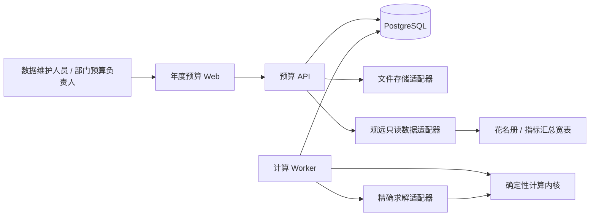
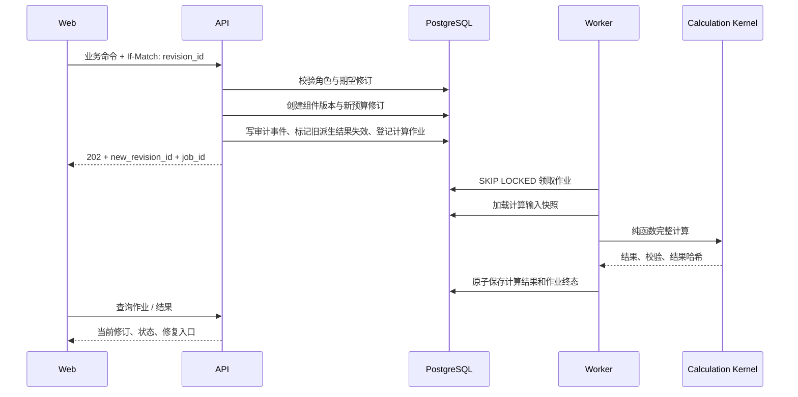

# 第一期系统架构

## 1. 架构结论

一期采用模块化单体。API 和计算 Worker 使用同一代码库、同一领域模型和同一 PostgreSQL 数据库，但以独立进程运行。同步命令只完成输入校验、创建不可变修订和登记作业；人数推演、完整复算、候选调平及大批量导出由 Worker 异步执行。

该边界保证一次业务命令可以在单一数据库事务中完成版本、确认失效和审计写入，又避免长计算占用 HTTP 请求。

## 2. 系统上下文



## 3. 模块边界

| 模块 | 责任 | 禁止事项 |
|---|---|---|
| `identity` | 用户、角色成员、角色快照 | 不判断预算业务规则 |
| `source_snapshot` | 读取只读数据源、冻结批次、源间对账 | 不修改观远资源，不混用不同截止链路 |
| `budget_versioning` | 年度预算、不可变修订、组件版本清单 | 不执行人数和收入公式 |
| `combination` | 六维预算组合及入口属性 | 不保存季节计算结果 |
| `entry` | 财年入口总值、校区建议、入口明细分配 | 不改变固定入口总值以闭合收入 |
| `parameter` | 比例、计划新生、班均、价格、税率转换、结转、折扣 | 不直接写计算结果 |
| `calculation` | 人数、取整、班均、收入、校验 | 不读取页面临时状态，只读取计算输入快照 |
| `optimization` | 三阶段候选生成、不可行证明、确定性排序 | 不直接应用方案或发布 |
| `workflow` | 锁定、确认、应用、发布和失效规则 | 不复制计算公式 |
| `audit` | 不可变审计事件和导出 | 不承担业务状态主存储 |
| `job` | 异步作业领取、重试、心跳和结果登记 | 不把技术失败解释为业务不可行 |

模块间只能通过应用服务接口调用；禁止跨模块直接更新对方数据表。计算内核是无数据库依赖的纯函数包，API 和 Worker 都只能通过其公开接口调用。

## 4. 推荐代码布局

```text
apps/
  api/
  worker/
  web/
packages/
  domain/
    identity/
    source_snapshot/
    budget_versioning/
    combination/
    entry/
    parameter/
    workflow/
  calculation_kernel/
  optimization_adapter/
  persistence/
  contracts/
migrations/
tests/
  unit/
  property/
  integration/
  acceptance/
```

`contracts` 保存 API DTO、稳定错误码和作业载荷版本。领域对象不得依赖 FastAPI、SQLAlchemy 或 OR-Tools；基础设施通过端口适配。

## 5. 核心执行链



如果 Worker 完成时该修订已不是草稿当前修订，结果仍作为历史结果保存，但状态为 `STALE`，不得成为页面当前值或正式确认依据。

## 6. 部署拓扑

一期最小生产拓扑：

- 2 个无状态 API 实例；
- 1 至 2 个 Worker 实例；
- 1 个 PostgreSQL 主库及标准备份；
- 1 个静态前端部署；
- 1 个文件存储适配器。

不要求 Redis、消息队列或微服务注册中心。数据库作业队列与业务事务共库，确保“新修订已提交但计算消息丢失”不会发生。未来拆分时以作业表和领域事件作为迁移边界。

## 7. 并发与幂等

- 所有写命令必须携带 `expected_revision_id`，HTTP 使用 `If-Match`；
- 当前修订不一致返回 `409 REVISION_CONFLICT`，响应包含最新修订 ID 和差异摘要；
- 每个命令携带调用方生成的 `idempotency_key`，同一用户、命令类型和键只执行一次；
- 批量命令整批事务成功或失败，不保留部分结果；
- 同一预算修订同一计算类型只允许一个有效作业，唯一键为 `revision_id + job_type + engine_rule_version`；
- 发布使用数据库行锁和唯一约束，防止同一草稿并发发布两次。

## 8. 故障语义

| 场景 | 业务结果 |
|---|---|
| API 事务失败 | 不创建新修订、不写部分审计、不登记作业 |
| Worker 崩溃 | 心跳过期后重试相同作业；输入快照不变 |
| 计算校验失败 | 作业成功结束，生成业务 `ValidationResult`；不是技术失败 |
| 求解器返回 `INFEASIBLE` | 保存不可行证明及约束摘要 |
| 求解器超时或 `UNKNOWN` | 标记 `CALCULATION_INCOMPLETE`，允许相同输入重试 |
| 当前修订已变化 | 保存历史结果并标记 `STALE` |
| 发布时输入指纹不一致 | 阻止发布，要求重新计算和正式确认 |

## 9. 初始容量假设

技术基线按单部门、最多 5,000 个预算组合、20,000 条季节结果、每个预算链 500 个修订、50 个并发在线用户设计。目标是普通查询 P95 小于 2 秒、完整基线计算 P95 小于 60 秒、调平作业默认 5 分钟软超时和 15 分钟硬终止。

这些是工程容量假设，不改变业务规则。上线前必须用脱敏 FY27 等规模数据压测；未达到时先优化查询、批量写入和求解模型，不通过减少校验或扩大容差换取性能。
