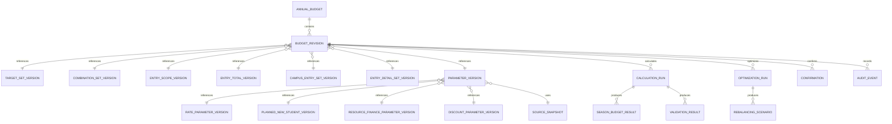

# 第一期数据模型与版本化

## 1. 建模原则

1. 业务输入、确认、计算结果和审计按精确预算修订绑定；
2. 已提交的业务组件版本只插入、不原地更新；
3. 预算修订是组件版本的不可变清单，未变化组件直接复用；
4. 当前草稿和当前发布版本只是指针，不代表覆盖旧版本；
5. 派生结果通过输入指纹判断有效性，失效时不删除；
6. 业务明细使用显式外键和唯一约束，不用 JSON 代替核心字段；
7. JSONB 只保存来源证据、差异摘要、不可行证明等结构可扩展但不参与核心关联的数据。

## 2. 类型约定

| 业务类型 | PostgreSQL 类型 | 约束 |
|---|---|---|
| 稳定 ID | `uuid` | 应用层生成 UUIDv7，一经创建永久不变；业务排序仍使用明确稳定键 |
| 人数终值 | `bigint` | 非负整数 |
| 理论人次 | `numeric(20,9)` | 只读中间值 |
| 金额（元） | `numeric(20,6)` | 不使用浮点；API 用十进制字符串 |
| 比例 | `integer`，字段后缀 `_ppm` | 0 至 1,000,000；百万分之一单位 |
| 百分点差异 | `integer`，字段后缀 `_ppm` | 可为负；绝对容差按整数比较 |
| 时间 | `timestamptz` | 统一保存 UTC，页面按 Asia/Shanghai 展示 |
| 内容指纹 | `char(64)` | 规范序列化后的 SHA-256 |
| 状态 | `text` + `CHECK` | 不使用数据库枚举，便于迁移 |
| 证据/差异 | `jsonb` | 必须有 `schema_version` |

比例换算：

- `100% = 1,000,000 ppm`；
- `0.01 个百分点 = 100 ppm`；
- `0.1 个百分点 = 1,000 ppm`；
- `0.05 个百分点 = 500 ppm`。

## 3. 关系总览

## 4. 版本主表

### 4.1 `annual_budget`

| 字段 | 说明 |
|---|---|
| `annual_budget_id` | 预算链 ID |
| `department_id` / `fiscal_year` | 一期唯一业务范围 |
| `current_draft_revision_id` | 当前可继续编辑的修订指针 |
| `current_published_revision_id` | 当前正式基线指针，可空 |
| `created_by` / `created_at` | 创建审计 |

唯一约束：`department_id + fiscal_year`。如未来允许同一财年多个独立方案链，再显式增加 `plan_code`，一期不预留含义不清的通配字段。

### 4.2 `budget_revision`

| 字段 | 说明 |
|---|---|
| `budget_revision_id` | 不可变修订 ID |
| `annual_budget_id` / `revision_no` | 所属预算链及单调序号 |
| `parent_revision_id` | 直接父修订，可空 |
| `command_type` / `idempotency_key` | 产生该修订的命令 |
| `target_set_version_id` | 目标组件 |
| `combination_set_version_id` | 预算组合组件 |
| `entry_scope_version_id` | 入口范围组件 |
| `entry_total_version_id` | 财年入口总值组件 |
| `campus_entry_set_version_id` | 校区入口组件 |
| `entry_detail_set_version_id` | 入口明细组件 |
| `parameter_version_id` | 完整参数清单 |
| `revision_content_hash` | 清单及组件内容哈希 |
| `created_by` / `created_at` / `role_snapshot_id` | 创建审计 |

唯一约束：`annual_budget_id + revision_no`、`annual_budget_id + idempotency_key + command_type`。

`budget_revision` 不保存可变状态。草稿、正式确认、发布、失效通过追加 `revision_lifecycle_event` 表达；`annual_budget` 的当前指针是可重建投影。

### 4.3 `parameter_version`

| 字段 | 说明 |
|---|---|
| `parameter_version_id` | 完整参数版本 ID |
| `source_snapshot_id` | 参数来源快照 |
| `rate_parameter_version_id` | 续班率、新生占比及边界 |
| `planned_new_student_version_id` | 计划新生人次集合 |
| `resource_finance_parameter_version_id` | 班均、原价、税率转换、结转节奏 |
| `discount_parameter_version_id` | 明细折扣和综合折扣目标 |
| `content_hash` | 全参数内容哈希 |
| `created_by` / `created_at` | 版本审计 |

参数版本确认写入独立 `confirmation`，不把 `approved=true` 回写到参数行。

## 5. 组件版本和明细表

每类组件均包含一个版本头表：`*_version_id`、`parent_version_id`、`content_hash`、`created_by`、`created_at`。明细表只引用版本头，不引用“当前版本”。

| 版本头 | 明细表 | 核心唯一键 |
|---|---|---|
| `target_set_version` | `budget_target` | 版本＋目标层级＋赛道 |
| `combination_set_version` | `budget_combination` | 版本＋赛道＋产品＋年级＋科目＋校区 |
| `entry_scope_version` | `entry_scope_exception` | 版本＋财年＋六个具体维度＋例外类型 |
| `entry_total_version` | `fiscal_year_entry_total` | 一个版本仅一行 |
| `campus_entry_set_version` | `campus_entry_allocation` | 版本＋校区 |
| `entry_detail_set_version` | `entry_detail_allocation` | 版本＋预算组合 |
| `rate_parameter_version` | `rate_parameter` | 版本＋参数类型＋完整参数键＋续班关系（适用时） |
| `planned_new_student_version` | `planned_new_student_count` | 版本＋组合＋季节 |
| `resource_finance_parameter_version` | `class_size_parameter` | 版本＋赛道＋产品 |
| `resource_finance_parameter_version` | `revenue_parameter` | 版本＋财季＋赛道＋产品 |
| `resource_finance_parameter_version` | `opening_carryover_parameter` | 版本＋第一财季＋赛道＋产品＋年级＋科目＋校区 |
| `discount_parameter_version` | `detail_discount_parameter` | 版本＋明细折扣键 |
| `discount_parameter_version` | `composite_discount_target` | 版本＋层级＋赛道＋年度/季节 |
| `discount_parameter_version` | `discount_parameter_confirmation` | 版本＋内容指纹 |

`budget_combination` 的唯一键故意不包含入口属性，从数据库层阻止同一公共五维因入口/非入口产生重复预算行。

`target_set_version` 还保存学校版目标来源证据、整套锁定状态、锁定人、时间和角色快照。部门与全部赛道目标必须在一个版本中整套导入并锁定；锁定是数据维护动作和独立审计事件，不建立额外业务审批。

目标闭合纵切已落库 `target_set_version`、`budget_target`、`target_closure_result_version` 和 `target_closure_result`。目标行固定保存 `10,000.000000` 元容差；闭合结果版本精确绑定目标版本与收入结果版本，逐目标保存计算收入、带符号差异和缺口/容差内/超额状态。目标版本替换保留不受目标影响的收入结果，只失效闭合结果及其下游；收入或更早上游变化则同步失效闭合结果。四张表均由数据库不可变触发器保护。

入口规划纵切采用下列已落库名称：`budget_combination_set_version` / `budget_combination`、`combination_set_confirmation`、`entry_total_version`、`campus_entry_suggestion_version` / `campus_entry_suggestion`、`campus_entry_set_version` / `campus_entry_allocation`、`campus_entry_confirmation`、`entry_scope_version` / `entry_scope_exception` / `entry_scope_evaluation`、`entry_scope_confirmation`、`entry_detail_set_version` / `entry_detail_allocation`。版本头通过 `budget_revision_id` 一对一绑定产生它的新修订；修订清单只引用版本 ID。上述版本、明细和确认表均由数据库触发器禁止 `UPDATE` 和 `DELETE`，外键删除策略为 `RESTRICT`。

`entry_total_version` 直接保存唯一的财年入口总值行，不另建一行明细表。`campus_entry_suggestion_version` 只是系统建议组件，不等同于业务确认后的 `campus_entry_set_version`。后者保存建议值、确定值、差额、三类业务依据和偏离原因；只有对应的 `campus_entry_confirmation` 存在且其输入指纹仍等于当前修订引用版本时，才能作为后续入口明细下拆输入。

`entry_scope_exception` 仅保存财年和赛道、产品、年级、科目、校区全部具体值的纳入/排除例外；`entry_scope_evaluation` 对当前每个启用组合冻结默认匹配、人工纳入、人工排除和最终结果，防止后续计算重新解释旧版本。`entry_detail_allocation` 保存人工预留与历史分配证据、理论值、向下取整值、余数、尾差归属、入口初始整数、默认软边界和候选资格；版本头用数据库约束保证明细合计严格等于已确认校区入口合计。

比例参数治理纵切已落库 `rate_parameter_version`、`rate_parameter`、`rate_boundary_confirmation` 和 `rate_parameter_copy_exception`。比例行保存完整无科目参数键、来源参考、系统值、当前值、上下界、锁定状态及锁定来源；边界确认独立保存“稳定键＋上下界”指纹，因此当前值在已确认范围内调整不会伪造一次新的边界确认。跨财年复制只使用去除财年的完整匹配键；未匹配、目标边界未确认或复制值越界等情况以不可变例外行保留，并使该比例版本不可发布。

计划新生人次治理纵切已落库 `planned_new_student_version` 和 `planned_new_student_count`。版本头绑定当前预算组合、入口范围和入口明细三个依据版本；明细稳定键包含财年、季节、赛道、产品、入口属性、年级、科目和校区。计划人数只允许非负整数，锁定值必须等于当前值；状态明确区分 `FILLED_PENDING_LOCK`、`LOCKED_ZERO` 和 `LOCKED_POSITIVE`。非入口明细没有入口分配行，因此 `entry_detail_allocation_id` 允许为空；若存在入口分配且入口初始值大于 0，服务层禁止再录入人工计划。所有版本和明细均由不可变触发器保护。

四季人数纵切已落库 `headcount_result_version`、`season_headcount_result`、`headcount_rounding_trace` 和 `headcount_validation_result`。版本头精确绑定预算组合、入口范围、入口明细、比例参数和可选计划新生版本，并保存计算规则版本、输入指纹和可发布状态。季节明细唯一键为“结果版本＋组合＋季节”，同时保存理论分数原文、九位小数解释值、整数人数、输入参数引用、人数来源和取整后实际比例。老生与新生各有一条取整轨迹；缺少业务输入时允许对应结果为空，并以不可变阻断校验解释，不得落默认零。

收入纵切已落库 `opening_carryover_parameter`、`discount_parameter_version`、`detail_discount_parameter`、`composite_discount_target`、`discount_parameter_confirmation`、`revenue_result_version`、`season_revenue_result`、`revenue_aggregate_result` 和 `revenue_validation_result`。期初结转从产品级参数拆为完整财务适用键，防止在多校区、多年级或多科目明细上重复计入。折扣版本整套覆盖“财季＋赛道＋产品＋年级”明细折扣及部门/赛道的年度/季度综合目标，并由部门预算负责人以版本内容指纹独立确认。收入结果版本精确绑定人数、班均、已确认资源财务、折扣版本及折扣确认；明细、汇总、校验及所有版本头同样由不可变触发器保护。0015 升级为兼容既有 0014 收入历史允许新增确认外键为空，但 0015 起的收入计算服务不会生成未绑定确认的新结果。

## 6. 来源快照

### 6.1 表

- `source_snapshot`：快照 ID、共同截止时间、状态、内容哈希；
- `source_snapshot_component`：数据集 ID、名称、分区、任务批次、抽取时间、行数、字段映射版本；
- `source_reconciliation`：指标、左右来源、分子、分母、差异、通过状态；
- `source_metric_aggregate`：精确维度的续班率、新生占比聚合分子分母；回退时必须再汇总这些分子分母，不平均明细比率；
- `entry_history_aggregate`：入口范围版本、校区/组合维度、业务新生人次；
- `source_mapping_verification`：字段物理名、业务口径、核验人、核验时间、证据引用。
- `rate_reference_version`：冻结快照派生的历史比例参考版本、目标财年、样本门槛、四季成熟证据和来源类型计数；
- `rate_reference`：去科目后的完整历史率键、精确分子分母、实际采用的参考分子分母、精确/回退/人工必填来源、回退原因和 ppm 系统初值。

一期不复制花名册原始学员行到预算业务库，只保存预算计算所需聚合数、来源定位和对账证据。读取规则固定为：指标宽表唯一最新 `MAX(dtdate)` 分区，花名册与宽表必须属于同一刷新截止链路。

只读预览先以零行请求获取服务端筛选总数，再按季节、年级等完整维度动态分块，逐块校验返回行数。只有预算相关分子分母全为 0 的不完整维度行可被排除，排除数量进入快照指纹和审计；带有效人次的不完整维度行直接阻断构建。

比例参考生成只允许读取 `FROZEN` 快照。来源聚合的科目维度必须先汇总，不能平均科目或明细比率；精确样本不足时仅去校区重新汇总。默认门槛 30 可由命令显式覆盖并随版本冻结。`system_value_ppm` 按 100 ppm（0.01 个百分点）取整；原始分子分母和参考 ppm 仍完整保留。新生占比达到或超过反推输入上限、分子大于分母或两级样本均不足时不生成系统值，转为人工必填。

### 6.2 快照状态

`DRAFT -> WAITING_FOR_SUMMARY -> RECONCILED -> FROZEN`

- `WAITING_FOR_SUMMARY` 允许查看，不能生成正式参数；
- 系统只读构建会在公式和逐键对账通过后连续记录 `RECONCILED` 与 `FROZEN`；数据维护人员通过发起的构建作业和分区配置控制本次快照；
- `FROZEN` 后不可修改，只能创建新快照。

## 7. 确认与生命周期

### 7.1 `confirmation`

| 字段 | 说明 |
|---|---|
| `confirmation_id` | 稳定 ID |
| `confirmation_type` | 组合、整套校区入口、比例边界、资源财务参数、折扣解锁、正式方案 |
| `budget_revision_id` | 被确认修订 |
| `object_version_id` | 被确认组件版本，可空 |
| `input_fingerprint` | 确认时依赖指纹 |
| `confirmed_by` / `confirmed_at` / `role_snapshot_id` | 确认审计 |
| `summary_json` | 页面展示过的确认摘要及模式版本 |

确认本身不可更新。失效时追加 `invalidation_event`，记录触发命令、新修订、失效对象、依赖边和原因。

正式方案确认已落库为 `formal_plan_confirmation`：记录确认请求来源修订、完整复算后的确认修订、`phase1-publication-gate-v1` 输入指纹、确认原因、完整检查摘要、计划新生明细、操作人及角色快照。确认成功时创建只增加 `formal_confirmation_id` 的不可变子修订；该 ID 指向确认实体，而不是可变状态字段。表由数据库触发器禁止更新和删除。

### 7.2 `revision_lifecycle_event`

事件类型：`DRAFT_CREATED`、`FORMAL_PLAN_CONFIRMED`、`PUBLISHED`、`CURRENT_POINTER_MOVED`。同一修订最多一个 `PUBLISHED` 事件；发布后业务表无更新权限。

发布事务只移动 `annual_budget.current_published_revision_id`，不复制预算明细。`PUBLISHED` 事件冻结正式确认 ID、发布输入指纹、修订清单、逐项发布检查、发布人角色快照和发布内容哈希；`CURRENT_POINTER_MOVED` 单独保存发布指针前后值。

## 8. 计算和求解结果

### 8.1 `calculation_run`

| 字段 | 说明 |
|---|---|
| `calculation_run_id` | 运行 ID |
| `budget_revision_id` / `parameter_version_id` / `source_snapshot_id` | 计算输入快照 |
| `engine_rule_version` | 计算规则版本 |
| `input_fingerprint` / `result_hash` | 输入与输出哈希 |
| `status` | QUEUED、RUNNING、SUCCEEDED、INCOMPLETE、FAILED、STALE |
| `started_at` / `finished_at` | 作业时间 |
| `error_code` / `error_detail_safe` | 技术失败摘要，不写敏感业务行 |

结果表：

- `season_budget_result`：理论/整数老生、新生、班均、收入与结转；
- `target_result`：部门及各赛道目标、差异、容差状态；
- `discount_result`：各层综合折扣及完整精度差异；
- `validation_result`：稳定校验码、范围、实际值、规则和修复入口；
- `rounding_trace`：分组、理论值、整数部分、余数、尾差归属和稳定排序键。

### 8.2 `optimization_run` 与候选

- `optimization_run`：绑定计算运行、阶段、场景目标、求解状态、求解器统计和证明摘要；同时固化 `solver_adapter`、枚举上限、求解时限、候选复算上限和局部组状态表行数上限，不允许读取运行时“当前默认值”补齐历史；候选复算上限与组状态表行数上限是两个独立资源边界，不能混用；
- `rebalancing_scenario`：可行性、字典序评分、结果哈希；
- `scenario_change`：对象键、原值、建议值、边界、锁定状态、收入影响；
- `infeasibility_proof`：模型版本、硬约束集、冲突/界限摘要、求解状态；
- `discount_unlock_request`：数据维护人员绑定当前修订、输入指纹、第二阶段精确不可行运行及证明发起申请；
- `discount_unlock_confirmation`：部门预算负责人对申请执行独立确认；申请存在表示 `REQUESTED`，同修订同输入指纹的确认存在才表示 `ACTIVE`，派生新修订后自然失效；
- `scenario_application`：从候选到新预算修订的原子应用记录，保存来源候选、求解运行、来源/结果修订、输入指纹、三类差异计数、新建组件版本、是否需要重新确认校区入口、失效组件清单、应用原因和操作人快照；候选与结果修订均唯一，表由数据库触发器禁止更新和删除。
- `scenario_application_revert`：一键撤销候选应用的不可变事实记录，唯一绑定原应用，保存被撤销修订、恢复依据的应用前修订、新生成修订、恢复组件键、失效结果键、完整复算作业、原因和操作人快照；撤销只追加新修订，不更新或删除 `scenario_application`。

候选方案不直接修改组件版本；只有“应用到草稿”命令才创建新组件版本和新预算修订。入口差异会生成新的入口明细版本，并把人工计划新生值和锁定状态原样重挂到新入口行；同校区内调整沿用原校区入口确认，改变校区合计则新建校区入口版本并要求部门预算负责人重新确认。比例差异生成 `SCENARIO_APPLY` 版本并继承已确认边界的授权链；折扣差异仅在候选绑定的折扣解锁仍有效时生成 `SCENARIO_APPLY` 版本及派生参数确认，均不等于正式方案确认。

`INCOMPLETE` 表示超时、资源不足、范围无法证明安全或只找到未证明最优的可行解；它既不是业务不可行，也不能作为折扣解锁依据。`optimization_run` 只有 `OPTIMAL` 才能产生正式候选，只有完整硬约束模型的 `INFEASIBLE` 才能产生业务不可行证明。

## 9. 作业与审计

### 9.1 `async_job`

核心字段：`job_id`、`job_type`、`dedupe_key`、`payload_json`、`status`、`attempt_no`、`available_at`、`locked_by`、`heartbeat_at`、`timeout_at`、`last_error_code`。

领取索引：`(status, available_at, job_type)`，Worker 使用 `FOR UPDATE SKIP LOCKED`。业务事务和作业登记在同一事务中提交。

候选应用登记 `job_type=CALCULATE_BUDGET_REVISION`、`calculation_pipeline_version=phase1-full-calculation-v1`，去重键为“来源修订＋流水线版本”。载荷只保存修订、部门、操作身份、角色、请求号、候选应用 ID 和校区确认阻断标记，不保存业务明细或凭据。结果保存四个结果版本 ID、最终修订、各阶段状态、目标闭合状态和可发布标记。校区入口待确认时作业进入 `INCOMPLETE`；确认动作只将同一作业重新置为 `QUEUED`，不复制输入或新建业务版本。

### 9.2 `audit_event`

`audit_event` 只插入，保存对象键、前后组件版本、差异摘要、原因、操作者、角色快照、预算修订、参数版本和请求追踪 ID。数据库角色禁止 UPDATE/DELETE；导出服务只按白名单关联键读取业务表，归档包和新增审计仍由应用事务写入。

### 9.3 `audit_archive_artifact`

每次归档申请先登记异步作业和审计截止时间，Worker 再把年度预算链、目标修订、来源快照、组件参数、人数与收入结果、校验记录、生命周期及截止时点前的预算链审计组装为 ZIP。包内 `manifest.json` 固化范围，`checksums.sha256` 校验每个文件；数据库同时保存 ZIP、清单哈希和整包哈希。归档记录使用不可变触发器，重复幂等请求返回同一作业；同一修订允许在新的截止时间再次生成新归档，以纳入后续发布和审计事件。

## 10. 关键数据库约束

- 所有具体业务维度 `NOT NULL`，不允许“全部”哨兵值；
- 人数非负，班均大于 0；
- 比例、上下限和锁定值使用 ppm 整数检查；
- 反推型新生占比上限 `<= 999900 ppm`；
- 校区入口建议预留、建议值和确定值均为整数；
- 已锁定计划新生人次不得为小数或负数；
- `source_snapshot` 的每个数据集分区在快照内唯一；
- 结果唯一键为 `calculation_run_id + combination_id + season_id`；
- 同一修订同一确认类型和输入指纹仅允许一个有效确认；
- 同一预算修订、作业类型和规则版本仅允许一个未终结作业。

跨行合计、最大余数、确认依赖和发布硬约束不能只靠 `CHECK`，由领域服务在事务内校验，并在数据库保存对应 `validation_result` 和输入指纹。

## 11. 规范序列化与指纹

指纹输入使用 UTF-8 JSON：对象键按字典序，集合按稳定 ID 排序，金额与比例使用规范十进制字符串，不包含页面文案、更新时间或数据库行顺序。指纹至少包含：

- 预算修订所有组件内容哈希；
- 参数版本和来源快照哈希；
- 计算规则版本；
- 维度主数据映射版本；
- 求解器业务模型版本（调平时）。

相同输入必须得到相同 `input_fingerprint`、计算结果哈希和候选排序。

## 12. 数据迁移与历史保留

一期首批迁移先导入维度主数据、FY27 学校版目标、参数初值和预算组合，再生成第一个系统修订；不得把 Excel 公式字符串作为正式计算逻辑。Excel 原文件作为来源附件保留哈希和导入记录。

维度主数据通过只读适配器按批次导入 `dimension_mapping_version`。外部编码、内部 UUID、有效期、来源批次和映射哈希一并冻结；计算和审计只引用明确映射版本，不在运行中按名称临时匹配。

一期不实施业务历史硬删除。若未来必须归档，先把发布基线、确认、结果、审计和来源证据导出成可验证归档包，再通过单独治理决策定义保留期。
